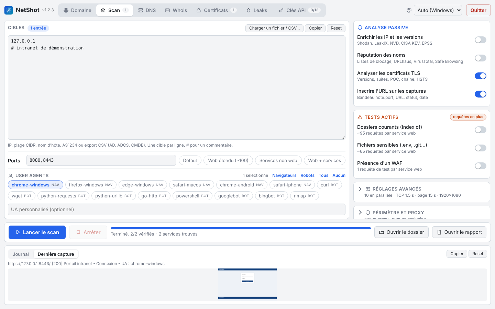

# netshot (Go)

Inventaire et capture d'écran des services web exposés, à partir d'IP, de subnets CIDR, de numéros
d'AS, de noms d'hôte, d'exports CSV (AD, ADCS, CMDB) ou de sous-domaines trouvés par des sources
passives (logs Certificate Transparency, DNS passif, archives web). Les IP trouvées sont enrichies
avec des sources gratuites (ports et CVE connus, fuites, priorisation KEV / EPSS).
Un seul exécutable portable, sans installation.



## 📁 Organisation du dossier

```
netshot-go/
├── README.md
├── build.ps1                 compile vers dist\
├── go.mod, go.sum
├── cmd/netshot/              code source (un seul package Go)
│   ├── main.go               options de la ligne de commande
│   ├── gui.go, gui.html      interface graphique (HTML intégré dans l'exe)
│   ├── scan.go               moteur : test des ports, captures, limite de débit
│   ├── browser.go            lancement et fermeture d'Edge/Chrome headless
│   ├── ct.go                 sources passives de sous-domaines
│   ├── ranges.go             plages d'un AS (RIPEstat), import CSV (AD, ADCS, CMDB)
│   ├── enrich.go             enrichissement des IP (InternetDB, LeakIX, KEV, EPSS, DNS inverse)
│   ├── keys.go               clés API des services gratuits
│   ├── dns.go, dns_*.go      client DNS (comme dig) et serveurs DNS du système
│   ├── tlsscan.go            analyse TLS et certificats (comme sslscan)
│   ├── tlsreport.go          sorties de l'analyse TLS (texte, CSV, rapport)
│   ├── whois.go              whois d'un domaine, d'une IP ou d'un AS (RDAP + port 43)
│   ├── leakcheck.go          fuites de données (LeakCheck Pro API v2), onglet Leaks
│   ├── pagecheck.go          contenu mixte, SRI, traqueurs, WAF (passif et -waf-probe)
│   ├── reputation.go         réputation des noms : résolveurs filtrants, URLhaus, VirusTotal, Safe Browsing
│   ├── settings.go           réglages de l'interface (thème) dans settings.json
│   ├── window_*.go           ouverture maximisée de la fenêtre (Windows)
│   ├── wordlist.go, subdomains.txt   dictionnaire de la force brute DNS
│   ├── report.go             report.html et results.csv
│   ├── webinfo.go            technologies, CVE (NVD), favicon, pages sensibles, pages similaires, en-têtes
│   ├── recon.go              fichiers sensibles, dossiers, JavaScript, robots, takeover, bannières, préréglages de ports
│   ├── dirs.txt, files.txt   dossiers courants (-dirs) et fichiers sensibles (-files), intégrés à l'exe
│   ├── scope.go              hors périmètre (-exclude) et proxy (-proxy)
│   ├── export.go             results.json et results.xlsx
│   ├── targets.go, ua.go     analyse des cibles et des ports, liste des user agents
│   ├── icon.png              favicon de l'interface (généré)
│   └── rsrc_windows_amd64.syso   icône de l'exe (généré)
├── tools/mkicon/             générateur de l'icône
├── assets/icon.ico           icône multi-tailles (référence)
└── dist/                     exécutables compilés + dossier screenshots\ par défaut (non versionné)
```

`keys.json` (clés API) et `settings.json` (thème) ne sont jamais versionnés (`.gitignore`).

## ✅ Prérequis sur le poste qui lance le scan

Rien à installer : `netshot.exe` + Edge ou Chrome (Edge est présent par défaut sur Windows 10/11).
Le navigateur est détecté automatiquement. Sinon : `-browser "C:\chemin\msedge.exe"`.

## 🖥️ Interface graphique

Double-clic sur `dist\netshot.exe` (ou lancement sans argument).
L'interface s'ouvre dans une fenêtre Edge/Chrome. Elle est servie en local sur `127.0.0.1`,
sur un port aléatoire et une adresse contenant un jeton aléatoire : elle n'est pas joignable depuis le réseau.

La fenêtre s'ouvre maximisée.

#### 🗂️ Onglets

Dans l'ordre du déroulé d'une reconnaissance :

| Onglet | Rôle |
|---|---|
| **Domaine** | Ouvert au démarrage. Recherche de sous-domaines dans les sources passives, avec filtres DNS ; les sources à clé restent grisées tant que la clé manque. Les noms trouvés sont ajoutés aux cibles du Scan. |
| **Scan** | Cibles, options, user agents, lancement des captures. Le nombre de cibles s'affiche dans l'onglet. |
| **DNS** | Enregistrements d'un domaine (comme dig), constats, ajout des hôtes aux cibles, copie au format dig. |
| **Whois** | Propriétaire d'un domaine, d'une IP ou d'un AS : tableau à gauche, texte WHOIS brut à droite, constats. L'onglet occupe toute la hauteur de la fenêtre. |
| **Certificats** | Analyse TLS des services https (bouton « Services https du dernier scan »), tableau trié du pire au meilleur, détail au clic, CSV dans le dossier de sortie. |
| **Leaks** | Fuites de données (LeakCheck, clé requise) : mots de passe masqués par défaut, tri, export CSV. |
| **Clés API** | Saisie des clés des services gratuits, avec le lien pour en obtenir une. Seuls les champs remplis sont enregistrés, `-` supprime une clé. |

#### 📸 Onglet Scan

- **Cibles** (à gauche) : saisie (IP, CIDR, `AS1234`, nom d'hôte, une par ligne) ou **Charger un fichier / CSV…**.
  Un compteur indique le nombre d'entrées et une estimation du nombre d'adresses (plages CIDR).
- **Ports** : liste libre ou préréglages en boutons (Défaut, Web étendu, Services non web, Web + services).
- **User agents** : boutons à cocher sous les ports, sélection rapide Navigateurs / Robots / Tous / Aucun,
  UA personnalisé. Aucun coché = UA du navigateur.
- **Analyse passive** (à droite, en bleu) : « Enrichir les IP et les versions », « Réputation des noms »,
  « Analyser les certificats TLS », « Inscrire l'URL sur les captures ».
- **Tests actifs** (en orange, désactivés par défaut, requêtes en plus) : dossiers courants (Index of),
  fichiers sensibles (.env, .git…), présence d'un WAF.
- **Réglages avancés** (replié, avec un résumé) : dossier de sortie, tests en parallèle, timeouts, délai entre
  deux captures, résolution (1366x768, 1920x1080 par défaut, 2560x1440, 4K, mobile).
- **Périmètre et proxy** (replié, avec un résumé) : voir « Périmètre et proxy ».
- **Barre d'action**, toujours visible en bas de l'onglet : Lancer le scan, Arrêter, progression, Ouvrir le
  dossier, Ouvrir le rapport.
- **Journal / Dernière capture** : deux onglets sous la barre d'action ; un point signale une nouvelle capture.
  Clic sur l'aperçu pour ouvrir l'image.

Chaque scan crée un sous-dossier `scan_<date>` dans le dossier de sortie (par défaut `screenshots\` à côté de l'exe).

#### 🧰 Partout

- **Journal** en bas de chaque onglet, sauf Whois.
- Boutons **Copier** et **Reset** sur les zones de texte, les tableaux et le journal.
- **Thème** choisi dans l'en-tête, gardé dans `settings.json` (à côté de `keys.json`) : Auto (suit Windows),
  Clair, Sombre, Terminal / SOC (bleu nuit, accent cyan, tableaux en police fixe), Orange (anthracite et
  orange), Nord (gris bleutés doux).

#### 🚪 Fermeture

- Fermer la fenêtre arrête le programme au bout de 10 secondes ; un scan en cours est arrêté proprement
  et son rapport écrit. Recharger la page ne l'arrête pas.
- La fenêtre console affichée à côté sert de journal technique ; la fermer arrête aussi le programme.

## ⌨️ Ligne de commande

```
netshot.exe 192.168.1.0/24
netshot.exe -f targets.txt -p 80,443,8080,8443 -o captures
netshot.exe 10.0.0.0/24 -d 2 -u browsers -u bots
netshot.exe 10.0.0.5 -u "MonScanner/1.0"
netshot.exe -list-ua
netshot.exe -ct exemple.fr -ct-private            # sous-domaines qui pointent vers une IP privée
netshot.exe -ct exemple.fr -ct-only > noms.txt    # liste seulement, sans scan
netshot.exe -ct exemple.fr -ct-sources all        # toutes les sources utilisables
netshot.exe AS3215 -p 443                          # plages IPv4 annoncées par l'AS
netshot.exe -f ad_computers.csv                    # export CSV (AD, ADCS, CMDB…)
netshot.exe -key domscan=XXXX -key leakix=YYYY -save-keys   # enregistre des clés
netshot.exe -list-sources                         # sources et clés configurées
netshot.exe -dns exemple.fr                       # enregistrements DNS, comme dig
netshot.exe -dns exemple.fr -dns-server 1.1.1.1   # en interrogeant un serveur précis
netshot.exe -whois exemple.fr -whois 8.8.8.8 -whois AS3215   # propriétaire (RDAP + WHOIS)
netshot.exe -tls exemple.fr -tls intranet:8443    # certificat et configuration TLS
netshot.exe 10.0.0.0/24 -tls-scan                 # scan puis analyse TLS des services https
```

| Option | Rôle | Défaut |
|---|---|---|
| `-f FILE` | fichier de cibles : une par ligne (`#` = commentaire) ou export CSV (répétable) | - |
| `-p PORTS` | ports, ex. `80,443,8000-8010`, ou préréglages `web`, `services`, `default` (mélangeables) | `80,443,8000,8080,8443` |
| `-o DIR` | dossier de sortie | `screenshots_<date>` dans le dossier courant |
| `-c N` | tests en parallèle | `10` |
| `-connect-timeout` | délai TCP (s) | `1.5` |
| `-page-timeout` | délai de chargement de page (s) | `15` |
| `-d` | secondes minimum entre deux captures | `0` (pas de limite) |
| `-u` | user agent : nom, `browsers`, `bots`, `all` ou chaîne libre (répétable) | UA du navigateur |
| `-list-ua` | liste les UA intégrés | - |
| `-version` | affiche la version de NetShot | - |
| `-ct DOMAINE` | ajoute aux cibles les sous-domaines trouvés par les sources passives (répétable) | - |
| `-ct-sources` | `default`, `all`, ou une liste (voir `-list-sources`) | `default` |
| `-key SOURCE=CLÉ` | clé API d'un service (répétable) | fichier de clés |
| `-save-keys` | enregistre les `-key` dans le fichier de clés | - |
| `-list-sources` | liste les sources et les clés configurées | - |
| `-no-enrich` | désactive l'enrichissement des IP, la recherche des CVE dans NVD et la réputation des noms | enrichissement actif |
| `-no-reputation` | désactive seulement la réputation des noms | réputation active |
| `-no-analyze` | désactive l'analyse des pages (technologies, pages sensibles, en-têtes, favicon, pages similaires, JS, robots, bannières, takeover) | analyse active |
| `-files` | teste les fichiers sensibles de `files.txt` (signature vérifiée) | non |
| `-files-wordlist FILE` | liste de fichiers à la place de `files.txt` (active `-files`) | - |
| `-waf-probe` | une requête de test par service web (chaîne XSS / SQL / `../` inoffensive) pour voir si un WAF bloque | non |
| `-dirs` | teste les dossiers de `dirs.txt` et capture les listes de fichiers trouvées | non |
| `-dirs-wordlist FILE` | liste de dossiers à la place de `dirs.txt` (active `-dirs`) | - |
| `-exclude CIBLES` | cibles hors périmètre : IP, CIDR, nom ou `*.domaine`, séparées par des virgules (répétable) | - |
| `-exclude-file FILE` | fichier de cibles hors périmètre, une par ligne (répétable) | - |
| `-proxy URL` | proxy des pages : `http://hôte:port` ou `socks5://hôte:port` | aucun |
| `-no-label` | n'inscrit pas hôte:port, URL, code HTTP et date en bas des captures | bandeau inscrit |
| `-dns DOMAINE` | affiche les enregistrements DNS du domaine (comme dig) et quitte | - |
| `-dns-server` | serveur DNS pour `-dns`, ex. `1.1.1.1` ou `10.0.0.1:53` | résolveurs du système |
| `-whois REQUÊTE` | propriétaire d'un domaine, d'une IP ou d'un AS (`AS1234`), puis quitte (répétable) | - |
| `-tls HÔTE[:PORT]` | analyse TLS et certificat d'un point d'accès, puis quitte (répétable) | port 443 |
| `-tls-scan` | après le scan, analyse TLS de chaque service https trouvé | non |
| `-ct-all` | garde aussi les noms qui ne résolvent plus dans le DNS | non |
| `-ct-private` | garde seulement les noms qui résolvent vers une IP privée | non |
| `-ct-only` | affiche les noms trouvés et quitte, sans scan | - |
| `-width` / `-height` | taille de la fenêtre de capture | `1920x1080` |
| `-max-hosts` | refuse au-delà de ce nombre d'adresses | `65536` |
| `-browser` | chemin de msedge.exe / chrome.exe | détection auto |
| `-gui` / `-no-open` | force l'interface / n'ouvre pas de fenêtre, affiche seulement l'URL | - |

`Ctrl+C` arrête le scan et écrit quand même le rapport.

## 🔎 Sources passives de sous-domaines

Toutes gratuites. Seul le nom de domaine leur est envoyé, rien n'est envoyé aux cibles.

| Source | Clé | Par défaut | Remarque |
|---|---|---|---|
| crt.name | non | oui | logs CT + historique, le plus complet. 100 requêtes/jour/IP. Domaine racine uniquement |
| Cert Spotter | optionnelle | oui | logs CT. Petit quota sans clé |
| HackerTarget | optionnelle | oui | DNS passif. 50 requêtes/jour sans clé |
| urlscan.io | optionnelle | oui | sites scannés par urlscan |
| VirusTotal | **requise** | oui si clé | DNS passif. 4 requêtes/minute : 4 pages max, espacées de 16 s |
| DNSDumpster | **requise** | oui si clé | enregistrements DNS |
| DomScan | **requise** | oui si clé | logs CT. 1 000 crédits/mois gratuits, 4-5 par page de 500 noms (3 pages max) |
| ViewDNS | **requise** | oui si clé | index ViewDNS. 250 requêtes d'essai puis payant ; 1 requête par page de 1 000 noms (2 pages max) |
| crt.sh | non | non | logs CT, souvent lent ou surchargé (30 s, 2 essais) |
| Wayback Machine | non | non | anciennes URL archivées. Lent : 6 000 URL max, résultat partiel |
| Shodan | **requise** | oui si clé | noms vus par les scans Shodan. 1 crédit de requête par domaine |
| Dictionnaire DNS | non | non | **actif** : force brute DNS avec 1 000 noms courants (`subdomains.txt`, intégré à l'exe) ou `-wordlist fichier`. Détection des wildcards : un DNS qui répond à n'importe quel nom est filtré |

Les sources sont interrogées en parallèle. Les wildcards (`*.exemple.fr`) sont ramenés au domaine.
Par défaut, seuls les noms qui résolvent encore dans le DNS sont gardés. Avec `-ct-private`,
seuls ceux qui pointent vers une IP privée (10.x, 172.16-31.x, 192.168.x…) restent :
pratique pour cibler les services internes publiés avec un certificat public.

Anubis (jldc.me) n'est pas inclus : le service ne répond plus.

## 🧭 DNS d'un domaine (comme dig)

`-dns exemple.fr` (ou l'onglet DNS) interroge le domaine comme `dig`, avec un client DNS intégré,
sans outil externe :

1. une requête **ANY** est tentée et son résultat affiché. La plupart des serveurs la refusent ou
   ne renvoient qu'un HINFO (RFC 8482) ;
2. chaque type est donc interrogé un par un : A, AAAA, CNAME, NS, SOA, MX, TXT, CAA, DS, DNSKEY, HTTPS ;
3. puis les noms utiles sous le domaine : `www`, `_dmarc`, `_mta-sts`, `_smtp._tls`, `default._bimi`,
   SRV Microsoft 365 (`_autodiscover`, `_sip`), Active Directory (`_ldap`, `_kerberos`, `_gc`,
   `_ldap._tcp.dc._msdcs`), XMPP, CalDAV.

Serveur : les résolveurs du système par défaut (donc les zones internes sont visibles depuis le
réseau interne), ou un serveur précis avec `-dns-server`. UDP avec EDNS0, puis TCP si la réponse
est tronquée ou vide (certains résolveurs comme 1.1.1.1 abandonnent les gros TXT en UDP).

Constats affichés : SPF (absent, multiple, `+all`, `~all`, `-all`), DMARC (absent, `p=none`,
`quarantine`, `reject`), DKIM (32 sélecteurs courants testés : Google, Microsoft 365, Mailchimp,
SendGrid, Mailjet, Brevo, Proton, Zoho, Fastmail… ; clé révoquée signalée), CAA, DNSSEC (DS publié),
MTA-STS, enregistrements Active Directory visibles. Le sélecteur DKIM réel peut être un autre mot :
« DKIM non trouvé » ne prouve pas son absence.

## 🪪 Whois d'un domaine, d'une IP ou d'un AS

`-whois exemple.fr` (ou l'onglet Whois) interroge deux sources en parallèle, sans outil externe :

- **RDAP** (registre officiel, JSON en HTTPS, serveur trouvé par les fichiers d'amorçage de
  l'IANA) pour le tableau : registrar et son numéro IANA, titulaire, contacts, abuse, dates,
  statut, serveurs de noms, DNSSEC ; pour une IP, la plage, le CIDR, le nom du réseau et le pays ;
- **WHOIS port 43** pour le texte brut : renvoi de l'IANA, puis le registre, puis le registrar pour
  les .com. Ce port est souvent filtré en entreprise : le tableau RDAP reste alors disponible.

Un sous-domaine est cherché sous son domaine enregistré. Constats pour un domaine : expiration
proche ou dépassée, verrou de transfert (absent = détournement plus facile), verrou du registre,
DNSSEC, titulaire masqué. Même résultat que la version Python.

## 🔒 Certificats et configuration TLS (comme sslscan)

`-tls hôte:port`, `-tls-scan` ou l'onglet Certificats. Pour chaque point d'accès :

- **Versions** : SSLv3, TLS 1.0, 1.1, 1.2 et 1.3, testées une par une ;
- **Suites de chiffrement** : toutes celles acceptées, par version, dans l'ordre de préférence du
  serveur, classées sûre / faible (CBC, 3DES, sans confidentialité persistante) / non sûre (RC4, DES,
  EXPORT, NULL, anonyme). 80 suites TLS 1.0-1.2 et les 5 suites TLS 1.3 sont testées avec des
  ClientHello construits à la main : les suites que Go ne sait pas utiliser (DHE, CAMELLIA, RC4…)
  sont donc aussi détectées ;
- **PQC (post-quantique)** : échange de clés hybride X25519MLKEM768 accepté ou non, et groupe négocié
  par défaut. (Aucune autorité publique ne délivre encore de certificat à signature post-quantique :
  seul l'échange de clés peut l'être aujourd'hui.)
- **Certificat** : sujet, SAN, émetteur, dates et jours restants, type et taille de clé, algorithme
  de signature, numéro de série, empreinte SHA-256, wildcard, auto-signé, chaîne, confiance selon
  le magasin Windows (les AC internes déployées par GPO sont donc reconnues), nom couvert,
  OCSP agrafé, Must-Staple, preuves Certificate Transparency (SCT) ;
- **HTTP** : ALPN (h2 / http/1.1) et en-tête HSTS.

Note : F (SSLv3, suite non sûre, certificat expiré, clé RSA < 2048), T (certificat non reconnu,
nom absent, signature SHA-1), C (TLS 1.0 / 1.1 acceptés), B (suites faibles), A, A+ (A + TLS 1.3 + HSTS).
Alertes à 30 et 15 jours de l'expiration.

Non couvert : vulnérabilités spécifiques (Heartbleed, ROBOT, renégociation, compression),
taille des paramètres DH.

## 🔑 Clés API

Comptes gratuits. Les clés sont dans **`keys.json`, à côté de l'exe**. S'il manque au lancement, un
modèle vide est créé ; un `keys.json` existant n'est jamais écrasé. À l'enregistrement, seuls les
champs remplis sont modifiés et l'ancien fichier est gardé en `keys.json.bak`. Le fichier contient les
clés en clair : ne pas partager un dossier qui le contient (il est exclu de git).
Saisie : bloc « Clés API » de l'interface, ou `-key source=CLÉ -save-keys`.
Une variable `NETSHOT_KEY_<SOURCE>` (ex. `NETSHOT_KEY_DOMSCAN`) remplace la clé du fichier.

Services acceptant une clé : certspotter, hackertarget, urlscan, virustotal, dnsdumpster, domscan,
viewdns, leakix, shodan, leakcheck, nvd, abusech (URLhaus), safebrowsing (Google Safe Browsing).

Non inclus : SecurityTrails (plus de formule gratuite). ViewDNS passe uniquement par son API officielle
(la page web est protégée par un contrôle anti-robot Cloudflare).

## 🌍 Plages d'IP d'un AS

Une cible `AS1234` est remplacée par les plages IPv4 annoncées par cet AS, lues dans RIPEstat
(gratuit, sans clé). La limite `-max-hosts` s'applique ensuite : un gros AS dépasse vite 65 536 adresses.

## 📄 Import CSV (AD, ADCS, CMDB)

`-f` et le bouton « Charger un fichier / CSV » acceptent un export CSV (séparateur `,` ou `;`).
Les colonnes dont le nom ressemble à un hôte sont lues (DNSHostName, Common Name, Subject Alternative
Name, FQDN, IPv4Address…). À défaut, toutes les cellules sont parcourues. Exemples d'export :

```powershell
Get-ADComputer -Filter * -Properties DNSHostName,IPv4Address | Select DNSHostName,IPv4Address | Export-Csv ad.csv -NoTypeInformation
certutil -view -restrict "Disposition=20" -out "CommonName,SAN" csv > adcs.csv
```

Les certificats émis par l'autorité interne (ADCS) sont l'équivalent interne des logs CT :
ils listent les noms des services internes protégés par TLS.

## 🛰️ Enrichissement des IP

Après le scan, chaque IP derrière les services trouvés est enrichie :

- **DNS inverse** (PTR), pour toutes les IP ;
- **Shodan** : avec une clé, la fiche complète de l'IP (organisation, ASN, pays, OS, service vu sur
  chaque port avec produit, version et titre de page, CVE, date du dernier passage) ; sans clé,
  **Shodan InternetDB** (gratuit) : ports ouverts, technologies (CPE), tags et CVE connus ;
- **LeakIX** (clé gratuite) : services indexés et fuites détectées ;
- **CISA KEV** : les CVE activement exploitées sont marquées en rouge ;
- **FIRST EPSS** : probabilité d'exploitation, utilisée pour trier les CVE.

Seules les IP **publiques** sont envoyées à Shodan et LeakIX ; les IP internes ne quittent jamais le poste.
Désactivable avec `-no-enrich` ou la case de l'interface.

### 🚦 Réputation des noms (listes de blocage, malware, phishing)

Chaque nom d'hôte **public** scanné est vérifié (un nom qui pointe vers une IP
interne n'est jamais envoyé). Désactivable avec `-no-reputation` (ou `-no-enrich`) ou la case
« Réputation des noms » de l'interface :

| Source | Clé | Ce qui est relevé |
|---|---|---|
| **Résolveurs DNS filtrants** | aucune | Quad9 (malware, phishing), Cloudflare 1.1.1.2 (malware), OpenDNS (phishing), AdGuard DNS (publicité, traqueurs) : un nom qui résout normalement (1.1.1.1) mais que ces résolveurs bloquent (NXDOMAIN, `0.0.0.0`, page de blocage) est signalé. Le port 53 sortant doit être ouvert ; sinon le journal l'indique |
| **URLhaus** (abuse.ch) | `abusech`, gratuite | URL malveillantes connues sur le nom (et combien sont encore en ligne), présence dans Spamhaus DBL et SURBL |
| **VirusTotal** | `virustotal` (déjà utilisée pour les sous-domaines) | nombre de moteurs qui classent le domaine malveillant ou suspect. API gratuite : 4 requêtes / minute, donc limité aux 8 premiers noms |
| **Google Safe Browsing** | `safebrowsing`, gratuite | malware, hameçonnage, logiciel indésirable, sur les URL capturées |

Niveau : **critique** (Safe Browsing, URL URLhaus en ligne, au moins 3 moteurs VirusTotal), **haute**
(bloqué par un résolveur de sécurité, connu d'URLhaus, 1 ou 2 moteurs), **moyenne** (seulement
suspect pour VirusTotal), **info** (bloqué seulement par AdGuard, donc publicité ou traqueur).
Section « Réputation » en tête du rapport, `reputation.csv`, onglet « Réputation » de `results.xlsx`.

## 🔬 Analyse des pages

Pendant la capture, NetShot lit ce que chaque page révèle, sans scan supplémentaire (seule requête en
plus : le favicon). Désactivable avec `-no-analyze`.

| Analyse | Ce qui est relevé |
|---|---|
| **Technologies** | serveur, langage, CMS, framework, équipement (FortiGate, NetScaler, BIG-IP…) et version, lus dans les en-têtes (`Server`, `X-Powered-By`…), les cookies, la balise `generator`, les scripts et le HTML. Avec l'enrichissement, les CVE de chaque version sont cherchées dans **NVD** puis classées avec CISA KEV et EPSS. Seuls le produit et la version partent vers NVD, jamais une adresse. Sans clé NVD : ~7 s par version ; avec la clé gratuite `nvd` : moins d'une seconde |
| **Pages sensibles** | `index-of` (liste de fichiers : « Index of / », « Directory listing for », IIS), `debug` (trace d'erreur, debug Django / Werkzeug, phpinfo), `default` (page par défaut Apache, IIS, nginx, Tomcat…), `admin` (interface d'administration), `login` (champ mot de passe), `auth-http` (401) |
| **Favicon** | hash MurmurHash3 identique au filtre Shodan `http.favicon.hash`, avec un lien de recherche Shodan |
| **Pages similaires** | hash perceptuel de chaque capture : les pages identiques sont regroupées et une case du rapport masque les doublons (jamais une page sensible) |
| **En-têtes de sécurité** | HSTS, CSP, anti-clickjacking, `nosniff`, `Referrer-Policy` absents, version divulguée, cookies sans `Secure` / `HttpOnly` / `SameSite`, mot de passe saisi en HTTP clair |
| **Contenu mixte et SRI** | ressources (scripts, styles, images, iframes…) et formulaires en `http://` sur une page HTTPS ; scripts et feuilles de style d'un autre site chargés sans attribut `integrity` (SRI). Lus dans la page déjà chargée, sans requête de plus |
| **Traqueurs et tiers** | ~80 services connus : mesure d'audience (Google Analytics, Matomo Cloud, AT Internet…), publicité, pixels des réseaux sociaux, analyse comportementale (Hotjar, Clarity…), bannières de consentement, Google Fonts, chat, monitoring ; plus la liste des hôtes tiers appelés par la page. Utile pour un contrôle RGPD |
| **WAF / CDN de protection** | Cloudflare, Akamai, Imperva, Sucuri, F5 ASM, AWS WAF / CloudFront, Azure Front Door / Application Gateway, FortiWeb, Barracuda, NetScaler AppFirewall, ModSecurity, Fastly, DDoS-Guard… lus dans les en-têtes et les cookies. Avec `-waf-probe` (désactivé par défaut, test **actif**) : une requête avec une chaîne d'attaque inoffensive dans l'URL, comparée à la page normale ; un code 403 / 406… ou une page de blocage confirme le filtrage et nomme souvent le produit |

Les versions lues dans les en-têtes sont indicatives : un serveur peut masquer ou mentir sur sa
version, et une distribution peut corriger une faille sans changer le numéro (rétroportage).

## 🕳️ Reconnaissance approfondie

| Analyse | Requêtes en plus | Ce qui est relevé |
|---|---|---|
| **Fichiers sensibles** (`-files`, désactivé par défaut) | ~65 par service web | `.env`, `.git/HEAD`, `.svn`, `.DS_Store`, `.htpasswd`, `web.config.bak`, `wp-config.php.bak`, clés SSH, sauvegardes `.zip` / `.sql`, `phpinfo`, `server-status`, Spring `actuator/env`, `elmah.axd`, Swagger… Chaque réponse doit contenir la signature du fichier : une page 404 personnalisée ne donne pas de faux positif. Seuls les 64 premiers Ko sont lus. Liste : `files.txt` (intégrée à l'exe) ou `-files-wordlist fichier` (chemin, gravité, signature séparés par une tabulation) |
| **Dossiers courants** (`-dirs`, désactivé par défaut) | ~95 par service web | `backup/`, `uploads/`, `logs/`, `.git/`… : les dossiers qui affichent une liste de fichiers sont capturés (tag `index-of`). Liste : `dirs.txt` ou `-dirs-wordlist fichier` |
| **JavaScript** | aucune | scripts du site chargés par la page et scripts en ligne : chemins d'API (`/api/…`, `/internal/…`), URL internes (IP privées, `.local`, `.corp`…), secrets (clés AWS, Google, Slack, GitHub, Stripe, JWT, chaînes de connexion, `client_secret`…). Les secrets sont **masqués** partout (`AKIA…MPLE`) avec le fichier et la ligne pour vérifier |
| **robots.txt, sitemap.xml, security.txt** | 3 par service web | chemins que le site demande de ne pas indexer (liens cliquables), nombre d'URL du sitemap, contacts sécurité |
| **Prise de contrôle de sous-domaine** | DNS seulement | nom dont le CNAME pointe vers un service cloud qui n'existe plus (S3, Azure, GitHub Pages, Heroku, Shopify, Fastly… : NXDOMAIN ou page « ressource inexistante ») |
| **Services non web** | 1 ou 2 connexions par port ouvert sans page web | bannière (SSH, FTP, SMTP, POP, IMAP, MySQL / MariaDB, Redis, VNC, Telnet, RDP) ; la version part dans les technologies, donc dans la recherche de CVE |
| **Identifiants par défaut** | aucune | rappel des identifiants par défaut connus de chaque techno trouvée (Tomcat, Grafana, RabbitMQ, NetScaler, BIG-IP…). **Rien n'est essayé** : c'est une liste à vérifier à la main, dans le cadre autorisé |

**Préréglages de ports** : `-p web` (une centaine de ports web : 81, 3000, 5000, 8081, 8888, 9090,
10000…), `-p services` (SSH, FTP, Telnet, SMTP, POP, IMAP, LDAP, bases de données, RDP, VNC, Redis,
MongoDB…), mélangeables : `-p web,services,8443`.

```bash
netshot 10.0.0.0/24 -p web,services -files -dirs
```

## 🎯 Périmètre et proxy

**Hors périmètre** : les cibles exclues par contrat ne sont jamais testées. IP, plage CIDR, nom
d'hôte ou `*.domaine` (tous les sous-domaines). Un nom qui pointe vers une plage exclue est exclu
aussi. Les cibles retirées sont listées dans le journal.

```bash
netshot 10.0.0.0/16 -exclude "10.0.5.0/24, prod-db.exemple.fr, *.partenaire.fr"
netshot -f cibles.txt -exclude-file hors_perimetre.txt
```

**Proxy** : `-proxy http://127.0.0.1:8080` (Burp, ZAP : tout le trafic web est tracé) ou
`-proxy socks5://hôte:1080` (rebond). Les pages, favicons, dossiers et fichiers passent par le
proxy. Le test des ports passe par le proxy SOCKS5 ; avec un proxy HTTP il reste direct (la réponse
d'un proxy HTTP ne dit rien de l'état du port). L'analyse TLS, l'enrichissement et NVD restent
directs. Proxy HTTP avec mot de passe : `http://user:motdepasse@hôte:port`. Edge envoie aussi un
peu de trafic Microsoft de fond par le proxy : il apparaît dans Burp.

## 📊 Résultats

- un PNG par service et par user agent : `<hôte>_<port>_<http|https>[_<ua>].png` ;
- `report.html` : captures groupées par `hôte:port`. Un badge orange signale les services dont
  la réponse change selon l'UA (code HTTP, titre, redirection, échec, taille de page qui varie
  de plus de 20 %). Une case à cocher n'affiche que ces services. Une barre de filtres reste en
  haut de l'écran : recherche (URL, titre, techno, tag), code HTTP, repère et technologie. En tête :
  réputation des noms, prises de contrôle possibles, fichiers exposés, pages sensibles, JavaScript, technologies,
  services non web, robots / sitemap, en-têtes de sécurité, WAF, contenu mixte et SRI, traqueurs,
  pages similaires ;
- `results.csv` : host, port, ua, url, status, title, final_url, size, file, error, tags, tech,
  favicon_hash, header_issues, visual_group, waf, waf_probe, mixed_content, no_sri, trackers,
  third_party_hosts ;
- `technologies.csv` : technologies et versions trouvées, URL concernées, CVE, KEV, EPSS et CVSS max ;
- `results.xlsx` : un onglet par thème (Services, Pages sensibles, Technologies, En-têtes, Fichiers
  exposés, JavaScript, Takeover, Services non web, robots et sitemap, Exposition, WAF / SRI / traqueurs,
  Réputation), avec filtres et
  en-tête figé, prêt pour un suivi des écarts ;
- `results.json` : tout le scan pour un autre outil ;
- avec l'enrichissement : un tableau « Exposition » en tête du rapport (IP les plus critiques
  d'abord), une ligne de synthèse sous chaque service, et `exposure.csv` (ip, noms, ports, CPE,
  CVE, CVE dans KEV, EPSS max, LeakIX).

Limite : seul l'en-tête `User-Agent` change. La page reste chargée par Edge/Chrome, qui envoie
ses autres en-têtes et exécute le JavaScript. Un vrai `curl` peut obtenir une réponse différente.
Le cache HTTP est désactivé pour que chaque UA reçoive une réponse fraîche.

## 🛠️ Compiler

Prérequis : Go (`winget install GoLang.Go`).

```
.\build.ps1             # dist\netshot.exe
.\build.ps1 -Linux      # + dist\netshot-linux
.\build.ps1 -Icon       # régénère l'icône avant de compiler
```

Ou à la main : `go build -ldflags "-s -w" -o dist\netshot.exe ./cmd/netshot`.

`gui.html` et `icon.png` sont intégrés dans l'exe (`go:embed`), l'icône Windows aussi
(fichier `.syso` généré par `tools/mkicon`, sans outil externe). Seul l'exe est à distribuer.

Notes techniques :

- chromedp est volontairement figé en v0.11.2. Les versions 0.15 à 0.23 changent l'API
  ou bloquent après le premier onglet.
- netshot lance lui-même Edge/Chrome headless avec un port de debug et un profil temporaire
  (`browser.go`), au lieu du lanceur de chromedp. Edge se relance parfois dans un processus
  enfant, ce que chromedp prenait pour un échec (« chrome failed to start »). Le navigateur est
  fermé par CDP à la fin ou à l'arrêt, et le profil temporaire est supprimé.

À utiliser uniquement sur des réseaux et des domaines que tu as l'autorisation de scanner.
